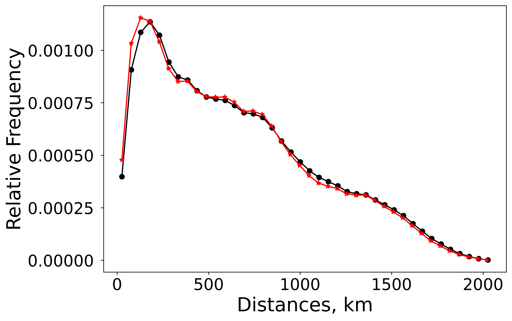
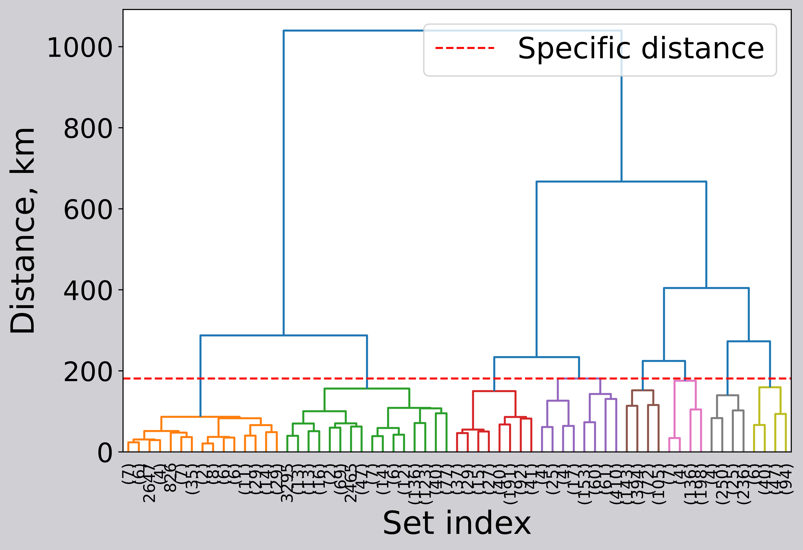

# Test results

Catalogue file: `catalog_bacground_proj.csv` (not included in this
repository). Kuril–Kamchatka, 4131 events, every `Aftershock` value
false. Magnitude 4.4 to 6.9, latitude 41.902° to 56.284°, longitude
144.32° to 163.97°, depth 10 km to 270 km, from 16 August 1990 to
17 August 2026.

The command below is the run that produced this table. It uses Python
3.11.7 and the pins in `requirements.txt`. `results/` is a local output
directory.

```bash
mkdir -p results
python -m spad_algorithm \
    --input catalog_bacground_proj.csv \
    --dense-events results/dense_events.csv \
    --clustered-results results/clustered_results.csv \
    --histogram-csv results/pairwise_histogram.csv \
    --histogram-png results/pairwise_histogram.png \
    --dendrogram-png results/dendrogram.png
```

## Selected parameters

| Quantity | Value |
| --- | --- |
| Events after the aftershock filter | 4131 |
| Freedman–Diaconis bins of the pairwise distances | 312 |
| \(q\) | -2.6999999999999997 |
| \(\beta\) | 0.8999999999999995 |
| \(r(q)\) | 68.50470798967017 km |
| \(\alpha\) | 14.291079899024027 |
| Dense groups | 48 |
| Events in dense groups | 3710 |
| Events outside the level set | 421 |
| Dense-group size | 4 to 258 events, median 59 |
| Modal distance \(\tau\) | 181.4697367713092 km |
| Seismogenic patches | 8 |

The stored \(q\) is the grid value nearest \(-2.7\). The stored
\(\beta\) is the grid value nearest \(0.9\). Both are the values
`numpy.arange` produced, and both are the values used in \(r(q)\) and
\(\alpha\).

## Events in each patch

Patch identifiers are the `cluster` column.

| Patch | Events |
| --- | ---: |
| 1 | 166 |
| 2 | 577 |
| 3 | 472 |
| 4 | 734 |
| 5 | 714 |
| 6 | 345 |
| 7 | 515 |
| 8 | 187 |

The eight counts sum to 3710.

## Figures

Black circles in the histogram are the positive pairwise distances of
all 4131 events. Red stars are the positive pairwise distances of the
3710 dense events. Both curves use 40 bins and density-normalised
counts. This histogram is not the one that sets \(\tau\).



The dendrogram is the centroid linkage of the dense events, truncated
at level 5. The dashed line is \(\tau = 181.4697367713092\,\mathrm{km}\).
Patch membership is the cut of the full tree at that distance.



Axis text requests Times New Roman. These files were written where that
font was not installed, so the labels use the fallback font. The curves,
the linkage, and the threshold line do not depend on the font.
